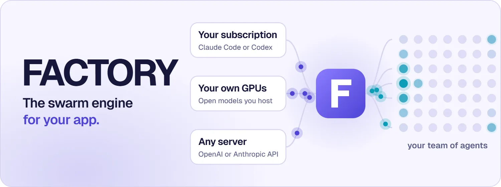

<picture>
  <source media="(prefers-reduced-motion: reduce) and (prefers-color-scheme: dark)" srcset="assets/banner-dark-still.webp">
  <source media="(prefers-reduced-motion: reduce)" srcset="assets/banner-light-still.webp">
  <source media="(prefers-color-scheme: dark)" srcset="assets/banner-dark.webp">
  
</picture>

<h3 align="center">Run a whole team of AI agents from a few lines of code.</h3>

<p align="center">
  FACTORY is a reusable swarm engine you drop into your own app.<br>
  Bring the AI subscription you already pay for, or host open models on your own GPUs.
</p>

<p align="center">
  <a href="https://github.com/flujo-app/FACTORY/releases/latest"></a>
  <a href="LICENSE"></a>
  
</p>

<p align="center">
  <a href="#try-it-in-a-minute"><b>Try it</b></a> &nbsp;·&nbsp;
  <a href="#bring-your-own-ai"><b>Bring your own AI</b></a> &nbsp;·&nbsp;
  <a href="#go-big"><b>Go big</b></a> &nbsp;·&nbsp;
  <a href="PUBLIC_SDK.md"><b>Full guide</b></a>
</p>

<br>

## Try it in a minute

```sh
npm install https://github.com/flujo-app/FACTORY/releases/download/v0.7.1/flujo-factory-0.7.1.tgz
```

```js
import { Factory } from 'flujo-factory';

const factory = new Factory('team.sqlite');

factory.createSwarm({
  mission: 'Build a landing page',
  agents: [
    { id: 'builder', role: 'developer' },
    { id: 'reviewer', role: 'verifier' },
  ],
});

factory.startLiteWorker({ provider: 'claude', prompt: 'Work on the Factory board' });
```

That's a team. Claude Code opens in your terminal on your normal login, sees the shared job board and gets to work. Change `'claude'` to `'codex'` to use Codex instead.

> [!WARNING]
> Workers can read, change and run anything on the computer they're on, with no permission prompts. Start them in a folder or machine you're happy to hand over.

<br>

## Bring your own AI

Your agents, your choice of brain. Switching is one setting.

| | 💳 Your subscription | 🖥️ Your own GPUs | 🔌 Any server |
|---|---|---|---|
| **Runs on** | Claude Code or Codex | Qwen or Nemotron, on your Modal account | Anything that speaks the OpenAI or Anthropic API |
| **You pay** | The plan you already have | From about $4.84 an hour while running, nothing when idle | Whatever that server costs |
| **Your code goes to** | That AI company | Nowhere. It stays in your account | That server |
| **Setup** | Sign in once | One function call | One setting |

<details open>
<summary><b>🖥️ Host your own model</b></summary>
<br>

Needs Python with `pip install modal`, and a signed-in Modal account. FACTORY sets up the GPU server, checks it works, and gives your agents the address and key.

```js
import { ModalSelfHostedModel } from 'flujo-factory';

const model = new ModalSelfHostedModel({ directory: '/private/model' });
await model.deploy({ profile: 'qwen' });

factory.startLiteWorker({
  provider: 'claude',
  modelProvider: model.endpoint(),
  providerKey: await model.key(),
});
```

When you're done, `await model.retire()` deletes it all. [More on self-hosting →](selfhost/README.md)

</details>

<details>
<summary><b>🔌 Use any server</b></summary>
<br>

```js
factory.startLiteWorker({
  provider: 'claude',
  modelProvider: {
    id: 'my-server',
    envKey: 'MY_MODEL_KEY',
    baseUrls: ['https://models.example.com/v1'],
    apis: ['anthropic'],
    model: 'my-model',
  },
  providerKey: process.env.MY_MODEL_KEY,
});
```

</details>

<br>

## Go big

The same idea, on as many cloud machines as you want. Needs a [Fly.io](https://fly.io) account and [flujo-cloud](https://github.com/flujo-app/flujo-cloud).

```js
import { FactoryCloudLiteFleet, ClaudeSubscriptionBroker } from 'flujo-factory';

const fleet = new FactoryCloudLiteFleet({
  directory: '/private/fleet',
  flujoCloudPath: '/path/to/flujo-cloud',
  auth: new ClaudeSubscriptionBroker({ tokenFile: '/private/claude-token' }),
});

await fleet.deploy({
  runId: 'launch',
  app: 'my-swarm',
  goal: 'Fix every open bug',
  workerProgram: 'claude',
  machines: 10,
  agentsPerMachine: 10,
}, { image, bundlePath });
```

<table>
  <tr>
    <td align="center" width="33%"><h1>100</h1>agents on 10 cloud machines<br><sub><a href="evidence/cloud-lite-run-20261014.json">in one real run</a></sub></td>
    <td align="center" width="33%"><h1>190</h1>agents sharing one GPU<br><sub><a href="selfhost/README.md#measured-long-agent-conversations-300-token-answers-histories-11k100k-tokens">in one real coding run</a></sub></td>
    <td align="center" width="33%"><h1>~$20</h1>of GPU time for that run<br><sub>2 hours 18 minutes</sub></td>
  </tr>
</table>

<br>

## What you get

<table>
  <tr>
    <td width="50%" valign="top"><b>🗂️ A shared job board</b><br>Agents claim work, so two never pick up the same job.</td>
    <td width="50%" valign="top"><b>✅ Independent review</b><br>One agent builds, another checks. <a href="WORKFLOWS.md">Work only counts once it passes.</a></td>
  </tr>
  <tr>
    <td valign="top"><b>♻️ Survives crashes</b><br>Restart any time. A job that was already sent is never sent twice.</td>
    <td valign="top"><b>💰 Budgets</b><br>Give each agent a share. It can't hand out more than it has.</td>
  </tr>
  <tr>
    <td valign="top"><b>🤖 Your choice of worker</b><br>Claude Code, Codex or <a href="https://github.com/mario-andreschak/FLUJO">FLUJO</a>, on your PC or in the cloud.</td>
    <td valign="top"><b>🧩 Use it your way</b><br>From your code, from the command line, or as an MCP tool for other agents.</td>
  </tr>
</table>

<br>

## Good to know

- **Budgets are bookkeeping.** They limit what FACTORY hands out. They don't stop your provider from charging you, so set limits there too.
- **Check your AI plan's terms** before running lots of agents on one subscription.
- **Not on npm yet.** Install from [GitHub Releases](https://github.com/flujo-app/FACTORY/releases), as shown above.
- **In the cloud you can lock agents down** with `sandbox: 'workspace-write'`. [See the guide.](PUBLIC_SDK.md#claude-code-as-the-worker-program)

<br>

## Learn more

[Full SDK guide](PUBLIC_SDK.md) &nbsp;·&nbsp; [Self-hosted models](selfhost/README.md) &nbsp;·&nbsp; [Reviewed workflows](WORKFLOWS.md) &nbsp;·&nbsp; [Early pilot notes](https://github.com/flujo-app/FACTORY/blob/main/PILOT_NOTES.md)

<sub>Part of the <a href="https://github.com/flujo-app">FLUJO</a> family. MIT licensed, including commercial use.</sub>
